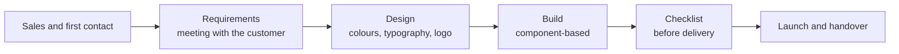

# Buildfloww

My own web business: I built and sold websites to local businesses, and handled the whole chain myself, from sales and requirements to design, development and delivery.

> Customer sites and source code are kept in private repositories. This page describes **how I worked**.

## What I delivered
- Websites for local businesses, built with **HTML/CSS**, **React / Next.js** and **Node.js**
- Mobile-first, with a contact form and a clear call-to-action on every site
- Supporting pages such as a privacy policy where the customer needed one

## How I worked

**1. Requirements before code.** Before any design work starts I ask the same questions every time: what the business does, the customer's brand colours, whether they have a logo or visual identity, and which typography fits their tone (I propose 2–3 options and wait for approval).

**2. A written design standard.** I wrote my own design guidelines for one target industry (construction) so every delivery holds the same quality:
- Fullscreen hero with a clear call-to-action, sticky navigation, contact form at the bottom of the start page
- Restrained animations (fade-in only), consistent spacing and border radius per component
- Colours as CSS variables based on the customer's brand, never hard-coded
- Explicitly banned: generic templates, and copying the look of earlier customer projects

**3. Reusable structure.** Sites are built from separate components (`ui`, `sections`, `layout`) with content passed in as props, so the next customer project starts faster.

**4. Quality check before delivery.** Every site goes through a checklist: colours and typography approved, hero with CTA, sticky nav, contact form, mobile-friendly, CSS variables used consistently.

## What it shows
- Selling to and working directly with customers
- Turning vague wishes into clear requirements and an agreed scope
- Standardising work so quality doesn't depend on the day
- Delivering finished products end to end

**Tech:** HTML, CSS, React, Next.js, TypeScript, Node.js, Tailwind, Framer Motion
